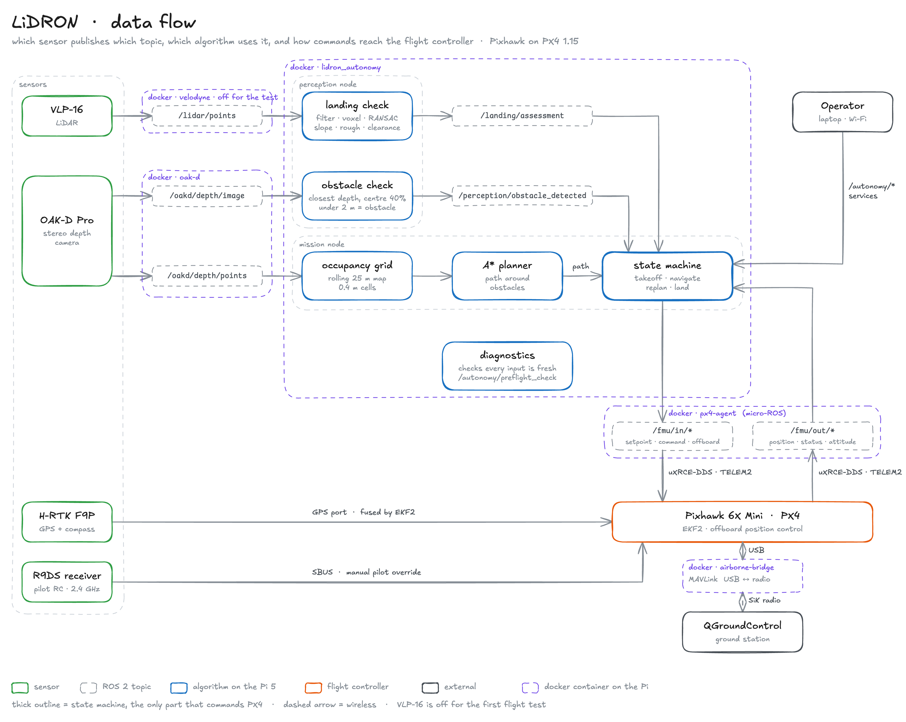
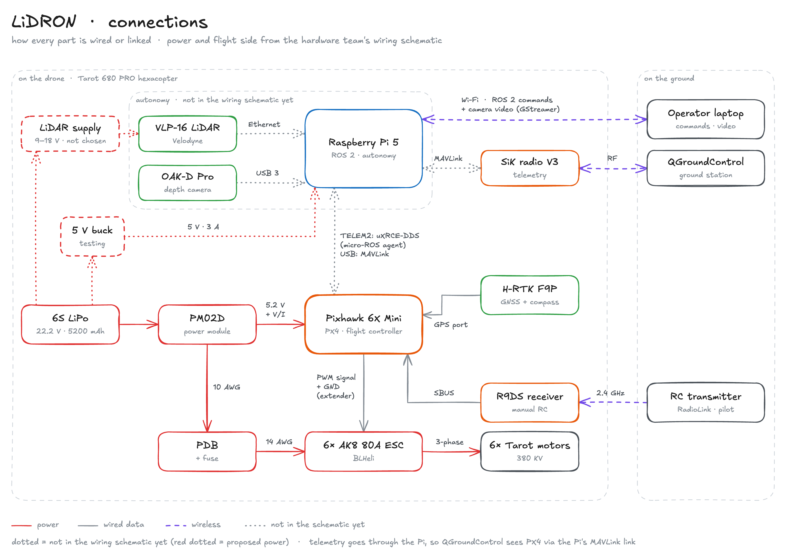

# Sensor-Control-Data-Gathering

These containers run on the drone's Raspberry Pi 5. They connect the Pixhawk, the OAK-D Pro camera and the VLP-16 LiDAR to ROS 2, so the [Autonomous-Systems](https://github.com/LiDRON7/Autonomous-Systems) code can read them and fly the drone.

## Start the flight-test containers

```bash
docker compose up -d --build airborne-bridge px4-agent oak-d
```

The flight-test drone has no LiDAR, so `velodyne` stays off. To check that PX4 and the camera are publishing:

```bash
docker exec oak-d bash -lc "source /opt/ros/jazzy/setup.bash && ros2 topic list | grep -E 'fmu|oakd'"
```

You should see `/fmu/out/vehicle_status` and `/oakd/depth/points`, among others.

## What each container does

| Container | Connects | Publishes |
| --- | --- | --- |
| `airborne-bridge` | Pixhawk USB and the SiK radio, both ways | `/telemetry/mavlink` |
| `px4-agent` | Pixhawk TELEM2 to ROS 2 | `/fmu/out/*`, and listens on `/fmu/in/*` |
| `oak-d` | OAK-D Pro over USB | `/oakd/depth/image`, `/oakd/depth/points`, `/oak/object_distances` |
| `velodyne` | VLP-16 over Ethernet | `/velodyne_points` |

<picture>
  <source media="(prefers-color-scheme: dark)" srcset="docs/architecture/data-flow-dark.png">
  
</picture>

How everything is wired and powered:

<picture>
  <source media="(prefers-color-scheme: dark)" srcset="docs/architecture/connections-dark.png">
  
</picture>

## Set up a new Pi (once)

1. Flash the Pixhawk with PX4 v1.15. In QGroundControl set `UXRCE_DDS_CFG = 102`, `SER_TEL2_BAUD = 921600` and `MAV_1_CONFIG = 0`.
2. Wire Pixhawk TELEM2 to the Pi's UART pins: TX to RX, RX to TX, GND to GND.
3. Add `dtparam=uart0=on` to `/boot/firmware/config.txt` and reboot.
4. Run `ls /dev/serial/by-id/` to get the Pixhawk's USB name. It changes when you flash PX4.
5. Create a `.env` file next to `compose.yaml`:

   ```bash
   PIXHAWK_DEVICE=/dev/serial/by-id/<name from step 4>
   PX4_AGENT_DEVICE=/dev/ttyAMA0
   ROS_DOMAIN_ID=0
   ```

6. Let the camera work without root, then unplug and replug it:

   ```bash
   echo 'SUBSYSTEM=="usb", ATTRS{idVendor}=="03e7", MODE="0666"' | sudo tee /etc/udev/rules.d/80-movidius.rules
   sudo udevadm control --reload-rules && sudo udevadm trigger
   ```

## Ground station

Use QGroundControl with the second SiK radio. Mission Planner can't switch PX4 flight modes reliably, so don't fly PX4 with it.

## Tests

```bash
docker compose config --quiet
docker run --rm --entrypoint bash sensor-control-data-gathering-oak-d:latest -lc "source /opt/ros/jazzy/setup.bash && source /opt/oak-venv/bin/activate && source /opt/oak_ws/install/setup.bash && python -m pytest -p no:cacheprovider /opt/oak_ws/src/oak_d_ros2/test -q"
```

## More

- [docs/topics.md](docs/topics.md): every topic, who sends it and who uses it.
- [CONTAINERS-WALKTHROUGH.md](CONTAINERS-WALKTHROUGH.md): every command for building, running and debugging each container.
- `docs/architecture/`: the data flow and wiring diagrams. Open the `.excalidraw` files at [excalidraw.com](https://excalidraw.com) to edit them.
