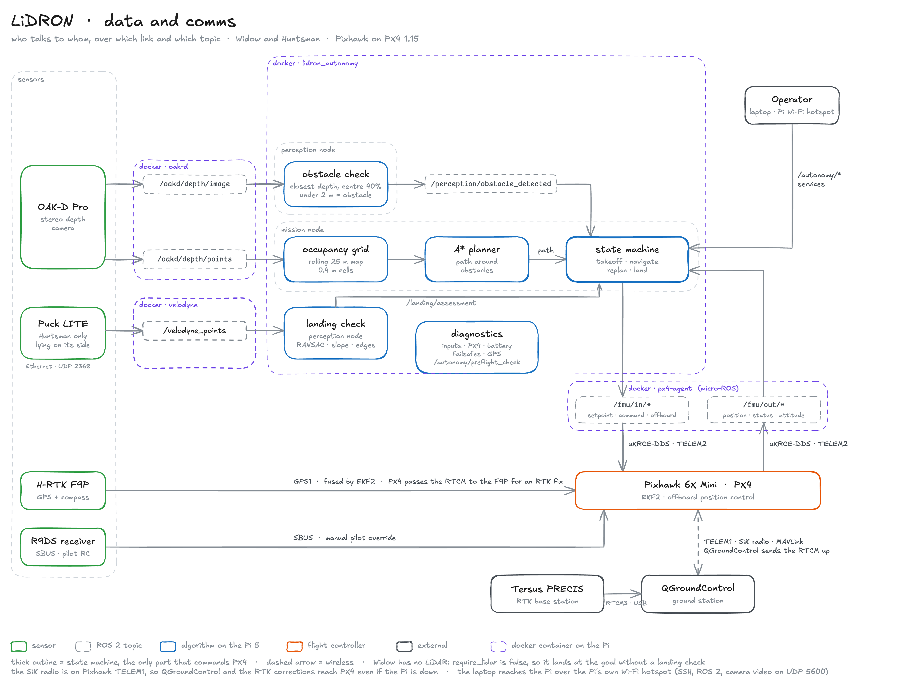
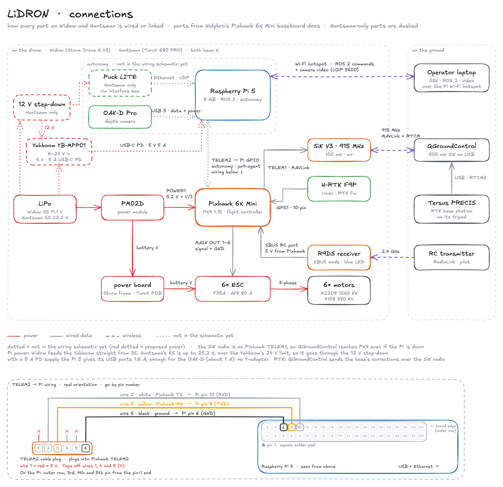
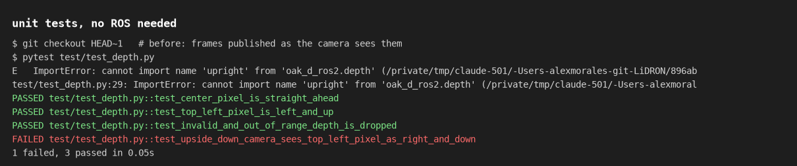
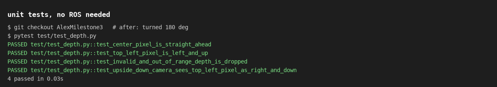

# Sensor-Control-Data-Gathering

These containers run on the drone's Raspberry Pi 5. They connect the Pixhawk, the OAK-D Pro camera and the Velodyne Puck LITE LiDAR to ROS 2, so the [Autonomous-Systems](https://github.com/LiDRON7/Autonomous-Systems) code can read them and fly the drone.

## Start the flight-test containers

```bash
docker compose up -d --build px4-agent oak-d
```

The SiK radio plugs into Pixhawk TELEM1, so QGroundControl talks to PX4 directly. `airborne-bridge` (radio on the Pi's USB instead) is off by default; start it with `docker compose --profile radio-bridge up -d airborne-bridge` only if the radio is on the Pi.

The flight-test drone has no LiDAR, so `velodyne` stays off. To check that PX4 and the camera are publishing:

```bash
docker exec oak-d bash -lc "source /opt/ros/jazzy/setup.bash && ros2 topic list | grep -E 'fmu|oakd'"
```

You should see `/fmu/out/vehicle_status` and `/oakd/depth/points`, among others.

## What each container does

| Container | Connects | Publishes |
| --- | --- | --- |
| `airborne-bridge` | Pixhawk USB and the SiK radio, both ways | `/telemetry/mavlink` |
| `px4-agent` | Pixhawk TELEM2 to ROS 2 | `/fmu/out/*`, and listens on `/fmu/in/*` |
| `oak-d` | OAK-D Pro over USB | `/oakd/depth/image`, `/oakd/depth/points`, `/oak/object_distances` |
| `velodyne` | Puck LITE over Ethernet (it is the light VLP-16, same driver and settings) | `/velodyne_points` |

<picture>
  <source media="(prefers-color-scheme: dark)" srcset="docs/architecture/data-flow-dark.png">
  
</picture>

How everything is wired and powered:

<picture>
  <source media="(prefers-color-scheme: dark)" srcset="docs/architecture/connections-dark.png">
  
</picture>

## Set up a new Pi (once)

Follow [docs/pi-setup.md](docs/pi-setup.md): wiring, Pi and PX4 settings, `.env`, and a 7-step check that everything works.

## Ground station

Use QGroundControl with the second SiK radio. Mission Planner can't switch PX4 flight modes reliably, so don't fly PX4 with it.

The Tersus PRECIS RTK base goes on the ground laptop's USB. QGroundControl sends its corrections up the SiK link and PX4 hands them to the drone's H-RTK F9P. Setup steps are in [Telemetry-Communication](https://github.com/LiDRON7/Telemetry-Communication#set-up-the-ground-station). The laptop reaches the Pi itself over the Pi's Wi-Fi hotspot (SSH, ROS 2, camera video on UDP 5600).

## Power

The Pi runs off a Yahboom YB-MPP01 board: 6 to 24 V in, 5 V / 5 A out over USB-C PD. Because it negotiates 5 A, the Pi gives its USB ports 1.6 A and the OAK-D runs straight off the Pi's USB, no Y-adapter. Widow feeds it from its 3S. Huntsman's 6S is up to 25.2 V, over the board's 24 V limit, so it feeds it from the 12 V step-down. Details in [docs/pi-setup.md](docs/pi-setup.md).

## The camera is mounted upside down

Both drones carry the OAK-D upside down so the cable clears the frame. `upside_down: true` in the `oak-d` container turns every depth frame and the video 180 degrees before publishing, so obstacles land on the right side of the map.

 

On the drone, put a hand on the camera's left and check it shows up on the left of `/oakd/depth/image`.

## Tests

```bash
docker compose config --quiet
docker run --rm --entrypoint bash sensor-control-data-gathering-oak-d:latest -lc "source /opt/ros/jazzy/setup.bash && source /opt/oak-venv/bin/activate && source /opt/oak_ws/install/setup.bash && python -m pytest -p no:cacheprovider /opt/oak_ws/src/oak_d_ros2/test -q"
```

## More

- [docs/connect-to-pi.md](docs/connect-to-pi.md): how to SSH into the drone's Pi, at the university or in the field.
- [docs/pi-setup.md](docs/pi-setup.md): wire the Pi, start the containers and check everything works.
- [docs/pi-known-issues.md](docs/pi-known-issues.md): every problem we hit on the Pi, why, and the fix.
- [docs/topics.md](docs/topics.md): every topic, who sends it and who uses it.
- [CONTAINERS-WALKTHROUGH.md](CONTAINERS-WALKTHROUGH.md): every command for building, running and debugging each container.
- `docs/architecture/`: the data flow and wiring diagrams. Open the `.excalidraw` files at [excalidraw.com](https://excalidraw.com) to edit them.
