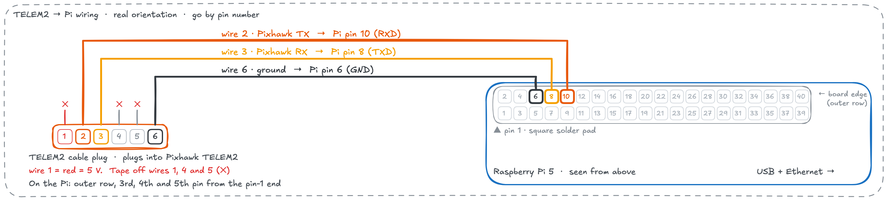
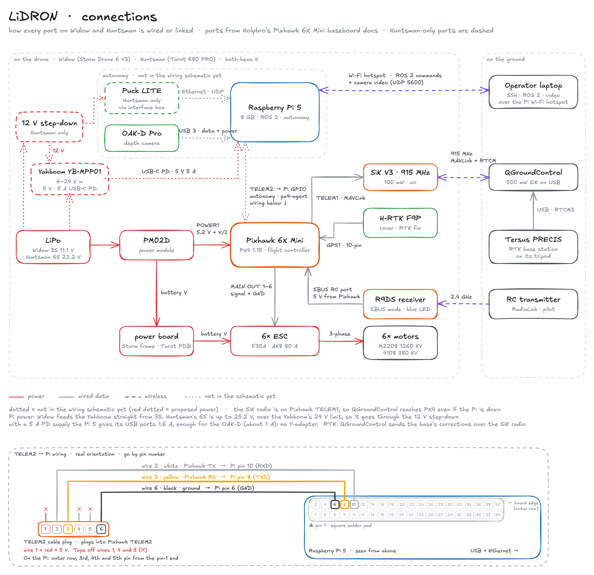

# Set up the drone's Pi

How to wire everything to the Raspberry Pi 5 (`lidron-cranberry`), start the containers, and check each part works. Do the sections in order.

To get into the Pi, see [connect-to-pi.md](connect-to-pi.md).

If something that used to work stops working, read [pi-known-issues.md](pi-known-issues.md) first. It lists every problem we hit and how to fix it.

## 1. Connect the hardware

| Part | Plug it into | Used by |
| --- | --- | --- |
| Pixhawk TELEM2 | Pi GPIO pins 10, 8 and 6 (see below) | `px4-agent` (autonomy talks to PX4) |
| SiK radio | Pixhawk **TELEM1**, not the Pi | QGroundControl on the ground radio |
| OAK-D Pro | a **blue** USB 3 port on the Pi (data and power) | `oak-d` |
| Pi power | a Yahboom YB-MPP01 board (6 to 24 V in, 5 V / 5 A USB-C PD out). Widow: straight from the 3S. Huntsman: from the 12 V step-down, because a full 6S (25.2 V) is over the board's 24 V limit | the Pi |
| Ground RTK base | Tersus PRECIS base on the laptop's USB, not on the drone | QGroundControl |
| H-RTK GPS (10-pin plug) | Pixhawk **GPS1**, not the Pi | PX4 |

The Yahboom board speaks USB-C PD, so the Pi 5 sees a 5 A supply and gives its USB ports 1.6 A. That is enough for the OAK-D Pro (about 1 A), so the camera no longer needs the Y-adapter. Check it: `vcgencmd get_config usb_max_current_enable` should print `1` without you setting it, and `dmesg` should show no undervoltage. If the camera still drops, see issue 10 in [pi-known-issues.md](pi-known-issues.md#10-the-camera-keeps-disconnecting). A few buyers say the board puts out 4.96 V with some noise, so watch for the Pi's low-voltage warning on the first bench run.

Don't also plug the radio into the Pi's USB. Its USB port and its TELEM1 cable share one serial line, so the Pi and the Pixhawk talk over each other and QGroundControl can't connect. With the radio on TELEM1, the ground link keeps working even if the Pi crashes. The Pixhawk's USB-C isn't needed in flight.

TELEM2 uses 3 of its 6 wires. Count from pin 1, the red wire.

The data wires cross: the Pixhawk's TX goes to the Pi's RX, and the Pixhawk's RX goes to the Pi's TX. RX to RX gets no data at all. Turn the Pi off before you touch its pins.

| TELEM2 wire | Pi pin |
| --- | --- |
| 1 (5 V, red) | nothing, tape it off |
| 2 (Pixhawk TX, white) | 10 (Pi RXD) |
| 3 (Pixhawk RX, yellow) | 8 (Pi TXD) |
| 6 (GND, black) | 6 (GND) |

<picture>
  <source media="(prefers-color-scheme: dark)" srcset="architecture/telem2-wiring-dark.png">
  
</picture>

On the Pi, all three are in the outer row (along the board edge): the 3rd, 4th and 5th pin from the end with pin 1.

<picture>
  <source media="(prefers-color-scheme: dark)" srcset="architecture/connections-dark.png">
  
</picture>

## 2. Set up the Pi (once per Pi)

`lidron-cranberry` already has all of this. Only do it on a new Pi.

1. Let your user run Docker and use the serial ports, then log out and back in:

   ```bash
   sudo usermod -aG docker,dialout $USER
   ```

2. Let the camera work without root:

   ```bash
   echo 'SUBSYSTEM=="usb", ATTRS{idVendor}=="03e7", MODE="0666"' | sudo tee /etc/udev/rules.d/80-movidius.rules
   sudo udevadm control --reload-rules && sudo udevadm trigger
   ```

3. Check the UART exists: `ls /dev/ttyAMA0`. If it doesn't, add `dtparam=uart0=on` to `/boot/firmware/config.txt` and reboot.

4. Stop Linux from using the UART as a login console. Otherwise it swallows everything PX4 sends:

   ```bash
   sudo systemctl mask --now serial-getty@ttyAMA0.service
   sudo sed -i "s/console=serial0,115200 //" /boot/firmware/current/cmdline.txt
   sudo reboot
   ```

5. Get both repos on `main`, in `~/LiDRON/`. `main` is the code that last flew or passed the simulator.

## 3. Set up PX4 (once per Pixhawk)

1. In QGroundControl, flash **PX4 1.15.x**. Not 1.16 or newer: they rename topics and autonomy gets no data.
2. Set the airframe to Generic Hexarotor x (6001) on both drones, with the Pixhawk and GPS arrows pointing at the camera. Run the motor test in Actuators.
3. Calibrate the sensors, the radio and the flight modes.
4. Set these parameters, then reboot (Vehicle Setup → Parameters → Tools → Reboot Vehicle):

   | Parameter | Value |
   | --- | --- |
   | `UXRCE_DDS_CFG` | `102` (TELEM2) |
   | `SER_TEL2_BAUD` | `921600` |
   | `MAV_1_CONFIG` | `0` |
   | `MAV_0_CONFIG` | `101` (TELEM1, the radio; this is the default) |
   | `SER_TEL1_BAUD` | `57600` (the radio's speed; this is the default) |
   | `COM_OBL_RC_ACT` | `4` (Land mode) |
   | `MPC_XY_VEL_MAX` | `2.2352` (m/s, about 5 mph; PX4 reads this in m/s, so don't type 5) |

   Set them in QGroundControl, not with a pymavlink script. A script that sends the number the wrong way saves `UXRCE_DDS_CFG` as `1120665600`, even though reading it back over MAVLink still shows `102`. PX4 then never starts the DDS client on TELEM2.

   **Offboard-loss failsafe:** `COM_OBL_RC_ACT = 4` configures PX4 to enter Land mode when offboard control is lost and the applicable failsafe is triggered. The currently verified timeout is `COM_OF_LOSS_T = 1.0 s`. This provides a fallback if the autonomy system stops sending offboard control updates.

   **Horizontal speed limit:** `MPC_XY_VEL_MAX = 2.2352` m/s (5 mph) limits the horizontal velocity commanded by PX4 during applicable position-controlled flight. Since autonomy sends position setpoints, PX4 determines the speed. This provides a conservative starting limit for the Widow flight tests.

5. After the reboot, check the parameters in the MAVLink Console (Analyze Tools → MAVLink Console):

   ```text
   param show UXRCE_DDS_CFG
   param show SER_TEL2_BAUD
   param show MAV_1_CONFIG
   param show MAV_0_CONFIG
   param show SER_TEL1_BAUD
   param show COM_OBL_RC_ACT
   param show MPC_XY_VEL_MAX
   uxrce_dds_client status
   ```

   Expected parameter values:

   ```text
   UXRCE_DDS_CFG : 102
   SER_TEL2_BAUD : 921600
   MAV_1_CONFIG : 0
   MAV_0_CONFIG : 101
   SER_TEL1_BAUD : 57600
   COM_OBL_RC_ACT : 4
   MPC_XY_VEL_MAX : 2.2352
   ```

   The DDS client should report `Running`. It may report `Running, disconnected` when the Raspberry Pi's XRCE-DDS agent is not connected.

   If the client says `not running`, set `UXRCE_DDS_CFG` again and reboot.

   **Verified on Pixhawk:** PX4 1.15.4dev, with `COM_OBL_RC_ACT = 4` (Land mode), confirmed using `param show COM_OBL_RC_ACT` in QGroundControl's MAVLink Console.

### USB MAVLink setup verified on Widow

For the [Issue #138 bench test](https://github.com/LiDRON7/Autonomous-Systems/issues/138), we used QGroundControl Daily over the SiK radio on TELEM1. The Raspberry Pi connected to the Pixhawk over USB, and the existing ROS 2 DDS connection stayed on TELEM2.

The test scripts opened the Pixhawk at `/dev/serial/by-id/usb-Auterion_PX4_FMU_v6X.x_0-if00`, the same path as `PIXHAWK_DEVICE` in the example below. On another Pi, run `ls -l /dev/serial/by-id/` to confirm the Pixhawk's path.

| PX4 parameter | Value observed on Widow |
| --- | --- |
| `MAV_0_FORWARD` | `1` |
| `SYS_USB_AUTO` | `2` |
| `USB_MAV_MODE` | `2` |

These values were already set on Widow when we tested. To check them on another Pixhawk, run `param show MAV_0_FORWARD`, `param show SYS_USB_AUTO`, and `param show USB_MAV_MODE` in the QGroundControl MAVLink Console.

## 4. Start everything

1. Create `~/LiDRON/Sensor-Control-Data-Gathering/.env`. `PIXHAWK_DEVICE` and `RADIO_DEVICE` are only used by `airborne-bridge`, which flight tests don't run, so they can stay as below:

   ```dotenv
   PIXHAWK_DEVICE=/dev/serial/by-id/usb-Auterion_PX4_FMU_v6X.x_0-if00
   RADIO_DEVICE=/dev/serial/by-id/usb-FTDI_FT231X_USB_UART_<your radio>-if00-port0
   PX4_AGENT_DEVICE=/dev/ttyAMA0
   SERIAL_GID=20
   ROS_DOMAIN_ID=0
   ```

2. Start the sensor containers:

   ```bash
   cd ~/LiDRON/Sensor-Control-Data-Gathering
   docker compose up -d --build px4-agent oak-d
   ```

3. Start autonomy:

   ```bash
   cd ~/LiDRON/Autonomous-Systems
   docker compose -f integration/compose.hardware.yml up -d --build
   ```

The first build takes about an hour on the Pi. After that, leave out `--build` and they start in seconds. They also start by themselves after a reboot.

## 5. Check it works

Checks 3, 5 and 6 run inside the autonomy container. To save typing, paste this line into the Pi's terminal once (each time you log in). It prints nothing, it just creates a shortcut called `auto`:

```bash
auto() { docker exec lidron_autonomy bash -c "source /opt/ros/jazzy/setup.bash && source /autonomy/install/setup.bash && $*"; }
```

Then put `auto` in front of any `ros2` command:

```bash
auto ros2 topic list
auto ros2 topic hz /fmu/out/vehicle_status
```

Press `Ctrl+C` to stop commands that keep running, like `topic hz`. Don't run `auto` alone or the `docker exec ...` part by itself: it fails with `syntax error: unexpected end of file`.

To work inside the container instead, run `docker exec -it lidron_autonomy bash`, then `source /autonomy/install/setup.bash`, and type `ros2` commands without `auto`. Type `exit` to leave.

| # | Check | Command | Good result |
| --- | --- | --- | --- |
| 1 | Radio link | connect QGroundControl to the ground SiK radio | it connects and shows the drone's status |
| 2 | TELEM2 link | `docker logs px4-agent` | a `create_client` line |
| 3 | PX4 reaches autonomy | `auto ros2 topic hz /fmu/out/vehicle_status` | a steady rate |
| 4 | Camera reaches autonomy | `auto ros2 topic hz /oakd/depth/points` | about 13 Hz |
| 5 | Obstacle detection | `auto ros2 topic echo --once /perception/obstacle_distance` | your hand's distance in meters |
| 6 | Everything at once | `auto ros2 service call /autonomy/preflight_check std_srvs/srv/Trigger` | `success=True` |
| 7 | Ground station | change the flight mode in QGroundControl over the radio | the mode changes on the drone |

When all 7 pass, do the props-off dry run ([Autonomous-Systems #84](https://github.com/LiDRON7/Autonomous-Systems/issues/84)).

Indoors, the GPS has no fix, so check 6 lists `gps` as stale. Run it outside.

## If something fails

Each of these is explained in more detail in [pi-known-issues.md](pi-known-issues.md).

| Problem | Fix |
| --- | --- |
| `px4-agent` has no `create_client` | 1) `uxrce_dds_client status` in the MAVLink Console says `Running` (step 3.5). 2) `systemctl status serial-getty@ttyAMA0` says masked (step 2.4). 3) The TELEM2 wires are tight and TX/RX are crossed. With the agent stopped, `stty -F /dev/ttyAMA0 921600 raw; timeout 4 cat /dev/ttyAMA0 \| wc -c` must print more than 0. |
| `oak-d` keeps restarting with `No available devices` or `Insufficient permissions` | The udev rule from step 2 is missing. Add it, then unplug and replug the camera. |
| Camera topics exist in `oak-d` but not in autonomy | Every container needs `FASTDDS_BUILTIN_TRANSPORTS=UDPv4` (it's in both compose files). |
| Camera rate is low | It's in a black USB 2 port. Move it to a blue one. |
| Camera connects, then drops every few seconds | Probably not enough power. See issue 10 in [pi-known-issues.md](pi-known-issues.md#10-the-camera-keeps-disconnecting) for the checks and fixes. |
| PX4 says no GPS, even with the LED on | Reseat the 10-pin plug in GPS1 and reboot the Pixhawk. Indoors it should still show as present, just with no fix. |
| QGroundControl can't connect over the radio | The radio must be on Pixhawk TELEM1 only, not also on the Pi's USB. Then check `MAV_0_CONFIG` and `SER_TEL1_BAUD` (step 3.5). |

For everyday commands (logs, restart, update), see the [containers walkthrough](../CONTAINERS-WALKTHROUGH.md).
